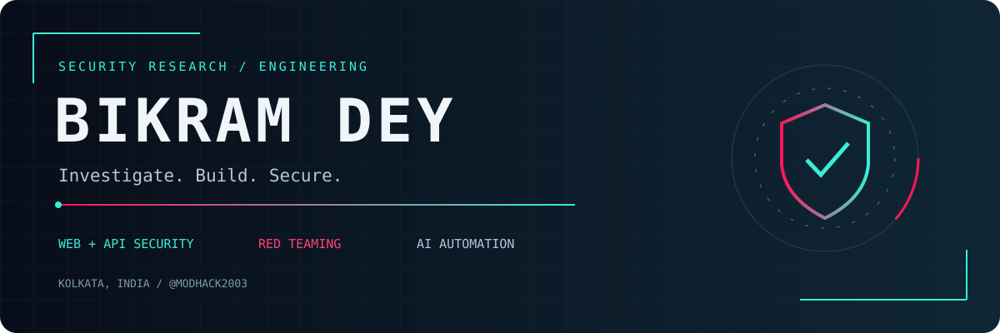
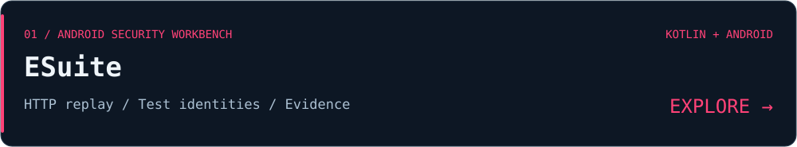
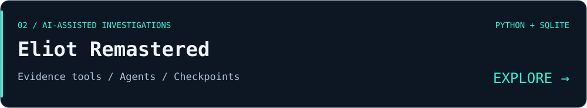
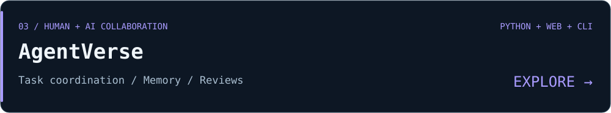

**Security Researcher · Bug Bounty Hunter · Security Tool Developer**

Web & API security • Penetration testing • AI-assisted security automation

Kolkata, India

[Portfolio](https://bikram-eight.vercel.app/) · [LinkedIn](https://www.linkedin.com/in/bikram-dey-700452997020031312/) · [Email](mailto:bikram20031213dey@gmail.com)

---

## 01 / THE RESEARCHER

I investigate web and API vulnerabilities and build tools that make security work easier to inspect, repeat, and document. My background spans web development, networking, competitive security challenges, and independent vulnerability research.

I work as an **independent security researcher and bug bounty hunter**, including participation on Bugcrowd. My long-term direction is penetration testing and red teaming, with an emphasis on understanding systems, producing clear evidence, and helping teams fix the underlying issue.

Alongside manual research, I explore custom AI agents and open-weight language models for security workflows. I treat reproducible evidence as the basis for a finding.

**Open to junior penetration testing, VAPT, and security automation opportunities in Kolkata or remotely.**

## 02 / BUILT TO INVESTIGATE

Each repository documents its current capabilities, setup instructions, and remaining limitations.

## 03 / RESPONSIBLE DISCLOSURE

**Ather Energy — validated medium-severity vulnerability**  
Accepted **4 September 2026** through its Responsible Vulnerability Disclosure Program.

Reported a PostgreSQL SQL injection issue in a web API, supplied reproducible evidence, and recommended parameterized queries and safer error handling.

## 04 / CTF COMPETITIONS

- **Cyber Quest 2026:** Team Byterixs placed **16th out of 100 teams**, achieving **10,000+ points** across web security and OSINT challenges.
- **Hacker's Gambit 2025:** **33rd place**.
- Additional participation: Indian Territorial Army CTF 2025, OPSWAT CIDX CTF 2026, and Ground Zero West Bengal Hackathon (ISOEH).

<b>Explore my technical toolkit</b>

## 05 / TECHNICAL TOOLKIT

| Area | Focus |
| --- | --- |
| Application security | Web/API VAPT, SQL injection, XSS, IDOR/BOLA, authentication and authorization testing, vulnerability reporting |
| Investigation | OSINT, network reconnaissance, CTF problem-solving |
| Languages | Python, JavaScript, TypeScript, SQL, Bash, Kotlin, Arduino C/C++ |
| Development | React, Next.js, Node.js, REST APIs, SQLite, MongoDB |
| Tooling and platforms | Kali Linux, Nmap, Git/GitHub, Docker; AWS and Azure fundamentals |
| Security automation | Agent Zero, custom AI agents, open-weight LLMs, evidence and reporting workflows |
| Embedded projects | ESP32, Raspberry Pi Pico W, GPIO, relays, OLED/I2C displays |

## 06 / CERTIFICATIONS

| Credential | Issuer | Issued |
| --- | --- | --- |
| [Certified Ethical Hacker (CEH)](https://aspen.eccouncil.org/VerifyBadge?type=certification&a=ZCbw2bUWOHvDyTejtMOgTk15A8UWVFWSbHQNrTdntw8=) | EC-Council | Mar 2026 |
| Certified Web Application Penetration Tester | IEMLabs UpSkill Academy | Jan 2026 |
| [Ethical Hacker](https://www.credly.com/badges/0887bdd6-db39-4b48-a015-ded4096c42d4/linked_in_profile) | Cisco Networking Academy | Jun 2026 |

Additional training and certificates

- **CCNA Routing and Switching training** — IEMLabs, Jan 2025.
- **Full Stack Web Developer** — IEMLabs, Jul 2024.
- **Certified Python Developer** — IEMLabs, Jan 2023.
- **[Introduction to Cybersecurity](https://www.credly.com/badges/c1f729ec-6cc3-4fdd-9b81-fc6e034f6d8f)** — Cisco Networking Academy, Sep 2025.
- **Web Development Bootcamp** — Microsoft, Jun 2024.

## 07 / EXPERIENCE & EDUCATION

- **Independent Security Researcher / Bug Bounty Hunter** — Apr 2026–present.
- **Web Developer**, Garden Reach Shipbuilders & Engineers Ltd. — Feb–Aug 2025.
- **Project Manager**, Ricoz — Jun–Sep 2024.
- **Diploma in Cybersecurity**, IEMLabs — 2023–2026.
- **Bachelor of Arts**, West Bengal State University — 2021–2025.

## 08 / LET’S CONNECT

For security opportunities, project collaboration, or a conversation about my work:

**[bikram20031213dey@gmail.com](mailto:bikram20031213dey@gmail.com)**  
[LinkedIn](https://www.linkedin.com/in/bikram-dey-700452997020031312/) · [Portfolio](https://bikram-eight.vercel.app/) · [Repositories](https://github.com/modhack2003?tab=repositories)
